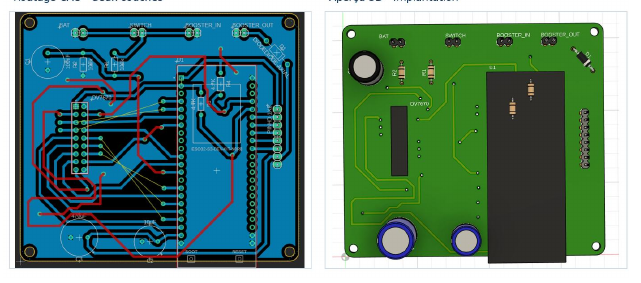
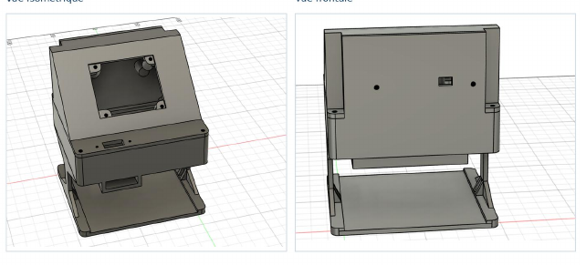
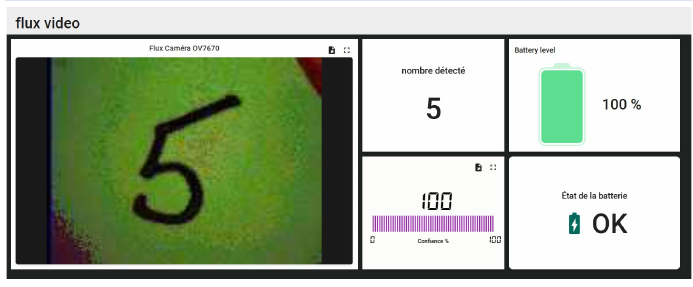

# Caméra intelligente — reconnaissance de chiffres manuscrits (ESP32-S3)

**Projet académique d'équipe — Technologie du génie électrique, électronique programmable — Cégep de l'Outaouais (automne 2026).**

Ce dispositif miniature a pour objectif de capturer un chiffre manuscrit avec une **caméra OV7670**, de le traiter sur un **ESP32-S3**, d'exécuter un modèle de classification **Edge Impulse (0 à 9)**, puis d'afficher le résultat sur un écran **TFT ST7735**. Le programme prévoit aussi la transmission de résultats, d'images et d'une information de batterie vers **ThingsBoard** via Wi-Fi/MQTT.

> **État du projet :** code embarqué, modèle d'inférence exporté, conception PCB et modèle de boîtier 3D fournis. Le rapport scolaire contient des exemples d'affichage et des validations fonctionnelles, mais aucune campagne d'essais chiffrée ne permet ici de calculer un taux de reconnaissance global. La compilation du projet et les essais sur le matériel n'ont pas été reproduits lors de la préparation de ce dépôt.

## Aperçu de la conception

| Circuit imprimé (Fusion 360 Electronics) | Boîtier 3D (Fusion 360) |
|:---:|:---:|
|  |  |

**Exemple de tableau de bord ThingsBoard documenté dans le rapport du projet :**



*Images extraites du rapport du travail d'équipe. L'illustration d'une prédiction ne représente pas à elle seule une mesure de précision statistique.*

## Architecture

```text
                         +----------------------+
                         | Camera OV7670        |
                         | 320 x 240 / RGB565   |
                         +----------+-----------+
                                    |
                                    v
                         +----------------------+
                         | ESP32-S3 N8R8        |
                         | Acquisition / PSRAM  |
                         | Pretraitement 28x28  |
                         | Edge Impulse (0-9)   |
                         +----------+-----------+
                                    |
                     +--------------+--------------+
                     |                             |
                     v                             v
           +-------------------+        +--------------------+
           | TFT ST7735        |        | Wi-Fi / MQTT       |
           | Image + resultat  |        | ThingsBoard Cloud  |
           +-------------------+        +--------------------+
```

La solution initiale explorait le **Raspberry Pi Pico 2 W**. La version de firmware fournie ici cible **l'ESP32-S3**, et non le Pico 2 W. Il s'agit de deux étapes du même projet, pas de deux microcontrôleurs utilisés simultanément dans cette version.

## Composants et technologies

- **Microcontrôleur :** ESP32-S3 (carte DevKit N8R8 dans le rapport).
- **Acquisition :** OV7670, capture QVGA en RGB565, PSRAM.
- **Affichage :** TFT 160 × 128, contrôleur ST7735, bus SPI.
- **Classification embarquée :** modèle exporté depuis Edge Impulse, entrée de 28 × 28 pixels, dix classes (`0` à `9`).
- **Communication :** Wi-Fi 2,4 GHz, MQTT, API télémétrie ThingsBoard.
- **Conception :** Fusion 360 Electronics (schéma/PCB), Fusion 360 (boîtier trois parties).
- **Développement :** C++ / framework Arduino / PlatformIO.
- **Alimentation :** le rapport final décrit quatre piles AA et un étage de conversion; **vérifier le câblage et la régulation avant tout essai**.

## Fonctionnement décrit par le code

1. Initialisation de la PSRAM, de l'écran, de la caméra OV7670 et, lorsque le réseau est activé, du Wi-Fi/MQTT.
2. Acquisition d'une image `320 x 240` et affichage réduit sur la zone `160 x 120` de l'écran TFT.
3. Extraction d'une zone centrale de `196 x 196` pixels, conversion en niveaux de gris puis réduction à `28 x 28`.
4. Inférence par Edge Impulse : seuil de confiance de **70 %** et stabilisation par **trois reconnaissances consécutives**.
5. Affichage local du chiffre retenu; publication MQTT du chiffre et de sa confiance lors d'un changement stable.
6. Fonction d'envoi périodique d'une image JPEG encodée en Base64 et d'une estimation de batterie vers ThingsBoard (prévue dans le programme; débit et fiabilité à tester sur le matériel).

**Attention :** le seuil de confiance de 70 % n'est **pas** un taux de réussite global de 70 %.

## Structure du dépôt

```text
camera-intelligente-esp32s3/
├── README.md
├── platformio.ini
├── .gitignore
├── include/
│   └── secrets.example.h          # Exemples sans vrais identifiants
├── src/
│   └── main.cpp                   # Application C++ ESP32-S3
├── lib/
│   └── camera_intelligente_inferencing/   # Export Edge Impulse
├── hardware/fusion360/
│   └── Schema-camera-intelligente.f3z
├── mechanical/fusion360/
│   └── Boitier-camera-intelligente.f3d
├── images/
│   ├── pcb-fusion360.png
│   ├── boitier-fusion360.png
│   └── thingsboard-exemple.png
└── docs/
    ├── GUIDE_GITHUB.md
    ├── NOTES_TECHNIQUES.md
    └── AVANT_PUBLICATION.md
```

## Installation dans VS Code / PlatformIO

1. Installer **Visual Studio Code** et l'extension **PlatformIO IDE**.
2. Ouvrir le dossier racine `camera-intelligente-esp32s3` dans PlatformIO (il contient `platformio.ini`).
3. Faire une copie de `include/secrets.example.h` nommée `include/secrets.h`.
4. Saisir **de nouveaux** identifiants Wi-Fi et un **nouveau** jeton ThingsBoard dans `include/secrets.h`. Ce fichier est ignoré par Git.
5. Brancher la carte ESP32-S3 adéquate, vérifier la configuration des broches et l'alimentation.
6. Lancer une compilation PlatformIO, puis le téléversement uniquement après contrôle du matériel.

Le firmware possède `#define USE_NETWORK 1`. Pour des essais hors réseau, le mettre à `0` dans `src/main.cpp`; le fichier local `secrets.h` reste requis pour la compilation. Le module Wi-Fi est 2,4 GHz; ne pas reproduire la mention « 5 GHz » qui apparaît dans un tableau du rapport.

> Le `platformio.ini` a été rendu portable par suppression du `build_dir = C:/pb` propre à l'ordinateur d'origine. Les bibliothèques déclarées dans `lib_deps` sont téléchargées par PlatformIO; `.pio/` n'est pas conservé dans Git. La bibliothèque Edge Impulse exportée a été conservée dans `lib/`, car l'application en dépend.

## Conception Fusion 360

- **Schéma et PCB :** [`hardware/fusion360/Schema-camera-intelligente.f3z`](hardware/fusion360/Schema-camera-intelligente.f3z)
- **Boîtier :** [`mechanical/fusion360/Boitier-camera-intelligente.f3d`](mechanical/fusion360/Boitier-camera-intelligente.f3d)

Ces fichiers natifs s'ouvrent dans Autodesk Fusion 360. Le `.f3z` est une archive de conception électronique et mécanique; le `.f3d` contient le modèle 3D du boîtier. Les fichiers de fabrication indépendants (Gerber/STL) ne figuraient pas dans les deux archives et ne sont pas présentés comme disponibles ici.

## Vérifications et améliorations possibles

- Mesurer l'exactitude sur une série d'images de chiffres et noter le protocole de test.
- Valider la liaison MQTT et la taille de ses messages sur le réseau réellement utilisé.
- Calibrer l'estimation de batterie selon la version finale à quatre piles AA.
- Vérifier l'alimentation, les niveaux de tension et les contraintes de montage du PCB.
- Documenter par une vidéo le fonctionnement final de la caméra, de l'écran et du tableau de bord.

Voir [`docs/NOTES_TECHNIQUES.md`](docs/NOTES_TECHNIQUES.md) pour une liste plus détaillée de points à tester.

## Auteurs, contributions et licences

Projet scolaire réalisé **en équipe de trois étudiants**. Les noms, contributions respectives et permissions de publication doivent être confirmés avec les autres membres avant que ce dépôt devienne public. Il faut également vérifier les modalités de diffusion applicables aux fichiers du cours.

Le sous-dossier `lib/camera_intelligente_inferencing/` inclut un export de modèle et des bibliothèques tierces (Edge Impulse / TensorFlow Lite Micro et dépendances). Ne pas prétendre que l'intégralité de ce code tiers est une création de l'équipe. Respecter les notices de licence fournies avec ces composants. **Aucune licence globale pour les créations de l'équipe n'est attribuée sans accord des coauteurs.**
