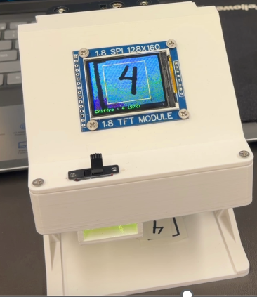
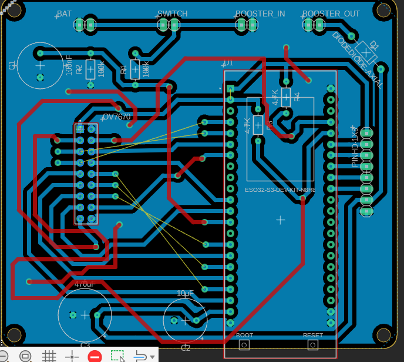
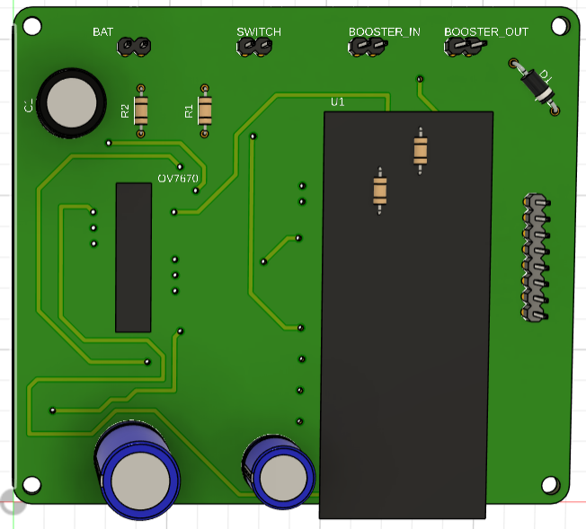
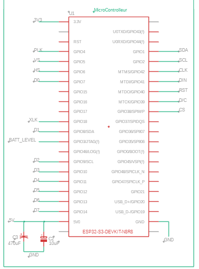
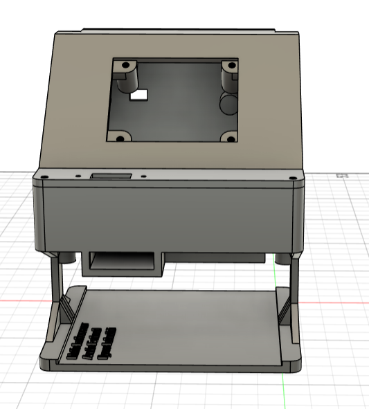

# Caméra intelligente ESP32-S3 — Reconnaissance de chiffres manuscrits

**C++ · ESP32-S3 · OV7670 · Edge Impulse · PlatformIO · Fusion 360 Electronics · Wi-Fi/MQTT**  
**Projet académique en équipe — Technologie du génie électrique, électronique programmable — Cégep de l’Outaouais, automne 2026**

> **English overview:** Embedded handwritten-digit recognition prototype (digits 0–9). An OV7670 camera feeds image data to an ESP32-S3, where an Edge Impulse model performs classification. The project also includes a TFT display, PCB design, a 3D enclosure and Wi-Fi/MQTT features for ThingsBoard.

Ce système embarqué vise à **capturer un chiffre manuscrit**, à traiter l’image avec un modèle d’intelligence artificielle exécuté localement sur un **ESP32-S3**, puis à **afficher le chiffre reconnu** sur un écran TFT. Le projet comprend aussi un circuit imprimé conçu sous Fusion 360 Electronics et un boîtier modélisé en 3D.

## Aperçu du prototype



*Photographie réelle du prototype fournie avec le projet. Le chiffre « 4 » est affiché sur l'écran ; cette image illustre une démonstration et ne constitue pas un taux de reconnaissance mesuré.*

**Explorer les réalisations :** [Code C++](src/main.cpp) · [Modèle Edge Impulse (export)](lib/camera_intelligente_inferencing/) · [Schéma et PCB Fusion 360](hardware/fusion360/Schema-camera-intelligente.f3z) · [Boîtier Fusion 360](mechanical/fusion360/Boitier-camera-intelligente.f3d) · [Notes techniques](docs/NOTES_TECHNIQUES.md)

## Fonctionnement

```text
Caméra OV7670 (image 320 × 240)
               │
               ▼
ESP32-S3 : acquisition et prétraitement
               │
               ▼
Modèle Edge Impulse : chiffres de 0 à 9 (entrée 28 × 28)
               │
       ┌───────┴────────────┐
       ▼                    ▼
 Écran TFT             Wi-Fi / MQTT
 Prédiction            ThingsBoard
                       (fonctions dans le code)
```

Dans le programme fourni, le traitement recadre et redimensionne l’image à **28 × 28 pixels** pour le modèle. Une prédiction n’est considérée comme stable qu’après **trois résultats identiques** dépassant un seuil de confiance configuré à **70 %**. Ce seuil n’est **pas** une mesure de précision du système.

La version publiée du firmware cible un **ESP32-S3 N8R8**. Une phase exploratoire a aussi utilisé un **Raspberry Pi Pico 2 W (RP2350)**, mais le code de cette version antérieure ne figure pas dans ce dépôt.

## Conception du PCB

La carte a été schématisée et routée dans **Fusion 360 Electronics**. Les images ci-dessous montrent la conception informatique, non une preuve de fabrication ou d’essais électriques d’une carte physique.

**Vue du routage :**



**Rendu 3D — face composants :**



**Schéma des connexions du microcontrôleur :**



Autres vues techniques : [schéma d’alimentation et mesure de batterie](images/schema-alimentation.png) · [caméra OV7670](images/schema-camera-ov7670.png) · [écran TFT](images/schema-ecran-tft.png) · [face des pistes du PCB](images/pcb-rendu-3d-pistes.png).

**Fichier de conception :** [Schema-camera-intelligente.f3z](hardware/fusion360/Schema-camera-intelligente.f3z).

## Boîtier 3D



Modèle conçu sous Fusion 360 pour intégrer les éléments électroniques. **Fichier natif :** [Boitier-camera-intelligente.f3d](mechanical/fusion360/Boitier-camera-intelligente.f3d).

## Technologies

| Domaine | Éléments utilisés |
|---|---|
| Programmation | C++, framework Arduino, PlatformIO |
| Microcontrôleur | ESP32-S3 N8R8 |
| Acquisition | Caméra OV7670, traitement d'image |
| Intelligence artificielle | Edge Impulse, classification 0–9 |
| Affichage | Écran TFT SPI ST7735 |
| Communications | Wi-Fi / MQTT, ThingsBoard (fonctions du programme) |
| Électronique | Schéma et routage PCB, Fusion 360 Electronics |
| Conception mécanique | Modélisation de boîtier, Fusion 360 |

## Organisation des fichiers

```text
camera-intelligente-esp32s3/
├── README.md
├── platformio.ini
├── src/main.cpp                       # Application embarquée
├── include/secrets.example.h          # Configuration exemple, sans mots de passe
├── lib/camera_intelligente_inferencing/  # Export Edge Impulse et code tiers
├── hardware/fusion360/                # Schéma / PCB
├── mechanical/fusion360/              # Boîtier 3D
├── images/                             # Photos et captures de conception
└── docs/                               # Notes techniques
```

Le contenu de `lib/camera_intelligente_inferencing/` inclut du code généré et des dépendances tierces. Il n’est pas entièrement écrit par les membres de l’équipe.

## Ouvrir avec PlatformIO

1. Ouvrir le dossier du dépôt dans **Visual Studio Code** avec l’extension **PlatformIO IDE**.
2. Copier `include/secrets.example.h` vers `include/secrets.h` et définir **de nouveaux identifiants personnels**. Ne jamais publier `secrets.h` (exclu par `.gitignore`).
3. Vérifier la configuration de la carte ESP32-S3 et les raccordements avant de compiler et de téléverser.
4. Tester sur le matériel compatible.

**Limites de validation :** aucune compilation indépendante sur une installation vierge n’a été reproduite pour cette publication. Les mesures d’exactitude, le comportement de reconnexion Wi-Fi/MQTT et la calibration de batterie restent à documenter avec un protocole reproductible. Les fonctions réseau sont présentes dans le code ; leur fiabilité n’est pas déduite de la seule photo du prototype.

## Travail en équipe et crédits

### Réalisation du projet

Ce projet a été réalisé en équipe de trois étudiants dans le cadre du DEC en technologie du génie électrique – électronique programmable au Cégep de l'Outaouais.

Nous avons travaillé ensemble sur les différentes étapes du projet :

- Conception des schémas électroniques et du circuit imprimé (PCB) avec Fusion 360 Electronics.
- Programmation du microcontrôleur ESP32-S3 en C++.
- Intégration de la caméra OV7670 et de l'écran TFT.
- Intégration du modèle de reconnaissance de chiffres avec Edge Impulse.
- Communication Wi-Fi/MQTT avec ThingsBoard.
- Conception du boîtier 3D sous Fusion 360.
- Assemblage, intégration et tests du système.

Les différentes étapes ont été réalisées en collaboration par les membres de l'équipe.
